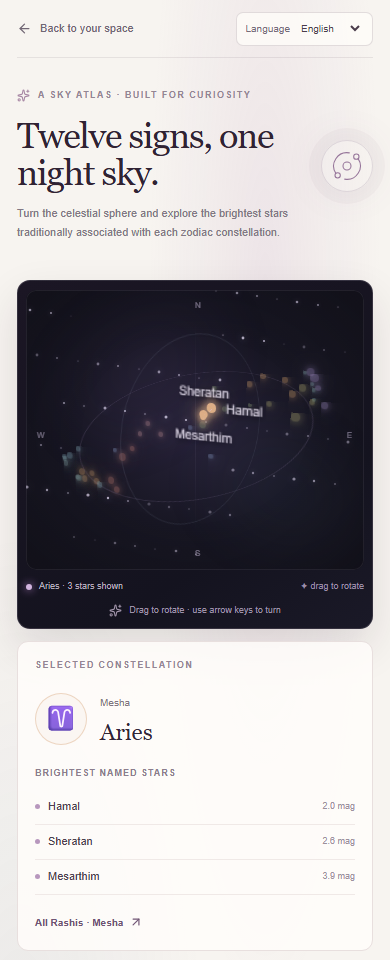
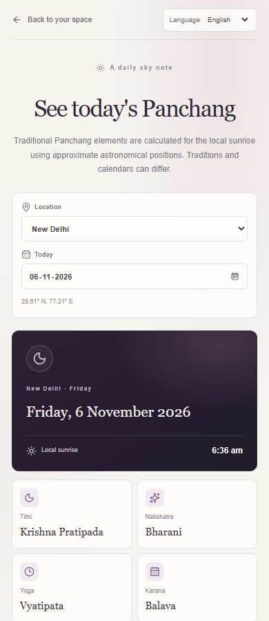

# Exploration and repository audit

## What I observed

I explored Melooha's public, logged-out surfaces on 2026-10-31. The homepage
presented Vaani and Astropedia modes, suggested questions, recent readings, and
a question-purchase dialog. I submitted one anonymous educational question and
received an answer; afterward, the composer displayed “Sign in to continue.”
The public FAQ describes Astropedia as free and unlimited, so I could not
reconcile that claim with the sign-in prompt.

I did not create an account, enter personal birth details, test personalized
Vaani/chart flows, or make a purchase. Store and FAQ descriptions are
published claims, not independently verified behavior. This is a small
logged-out exploration, not a review of Melooha's internal design.

The flow raised a product question: can a beginner learn something useful
before sharing sensitive birth details, and can the support for an answer be
made visible? That led to Aster: general concept learning first, reviewed
evidence alongside answers, and optional sky/calendar exploration rather
than ungrounded personal predictions.

## Opportunities and trade-offs

| Opportunity | Benefit | Cost / risk |
| --- | --- | --- |
| Evidence-first answers | Inspectable, testable explanations | Small corpus narrows coverage |
| Saved insights | Supports return learning | Requires persistence and jobs |
| Interactive sky atlas | Makes astronomy explorable | Must distinguish signs from IAU constellations |
| Multilingual answers | Widens access | Small reviewed set needs ongoing language review |
| Personal chart readings | Higher personalization | Requires validated calculations, consent, and privacy safeguards |

I prioritized evidence-first learning and saved insights. Personal predictions
remain out of scope until chart facts and interpretation can be validated.

## Build and verification

Aster is an independent Next.js, TypeScript, PostgreSQL, and Drizzle prototype.
Its small reviewed corpus favors provenance over broad chatbot coverage;
providers select evidence IDs, and the server composes answers from validated
stored facts. Local smoke checks covered Hindi Q&A, Panchang location/date
changes, and the sample chart calculation. ESLint, TypeScript, all 35 unit
tests, and the production build passed. Phone-width browser checks confirmed
the sky/Panchang layouts at 390 CSS pixels; these checks are not a full
automated end-to-end suite.

The guest cookie is not production identity or abuse prevention. Cookie
clearing can create another session, and no real-user retention measurement
exists. See the [architecture note](./architecture.md) for boundaries.

## Screenshots

These are cropped figures from 390 CSS-pixel phone viewport captures of the
local app. The sky view shows the interactive atlas and selected constellation;
the Panchang view shows location/date controls and calculated calendar values.

| Interactive constellation sky | Daily Panchang |
| :---: | :---: |
|  |  |

The repository and app are not public yet; the captures document the local
build, not a live deployment.
